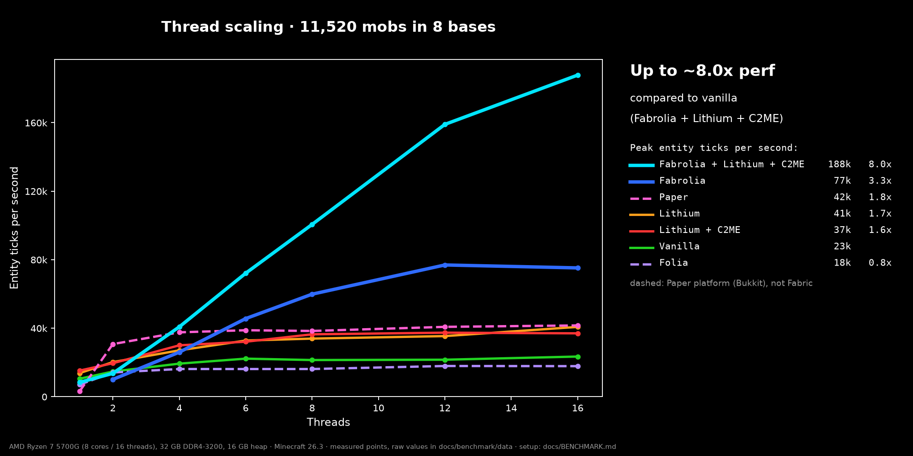
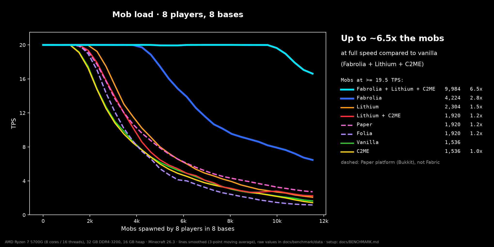
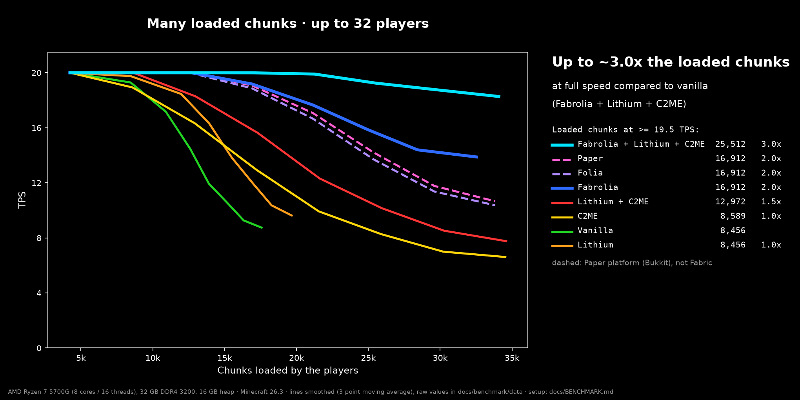
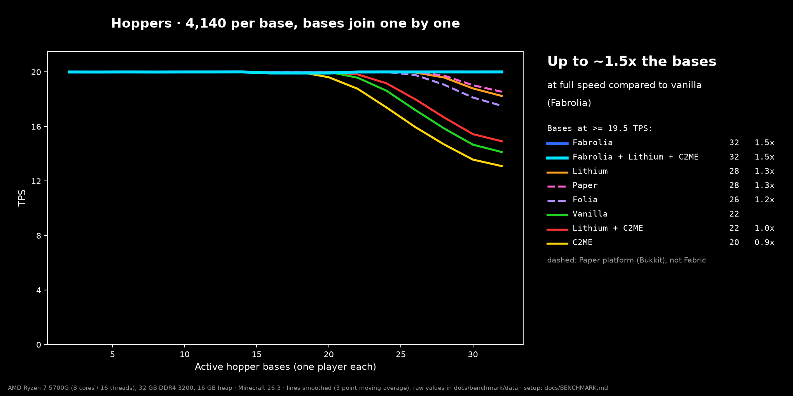
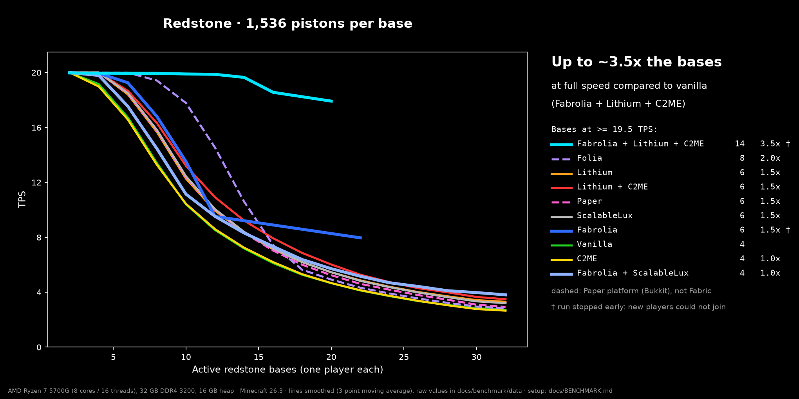
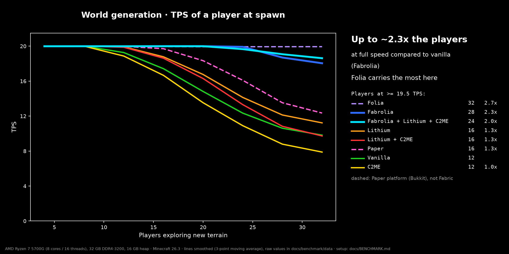

# Benchmark and release check (Fabrolia 3.1.11-alpha, Minecraft 26.3)

Measured on 2026-10-23/24 on one machine. The tools are in
[tools/bench](../tools/bench/README.md); every input is pinned by URL and SHA-256
in [inputs.py](../tools/bench/inputs.py). The raw per-second samples of all 92 runs
are in [data/raw-results-2026-10-24.tar.gz](benchmark/data/raw-results-2026-10-24.tar.gz)
(one `bench.json` per run), the plotted points as CSV in [data](benchmark/data).

"Fabrolia" always means its defaults from 3.1.11 on: async islands and island-owned
player ticks on.

## Summary

Load each configuration carried at full speed (every step ≥ 19.5 TPS):

| Scenario | Vanilla | Lithium | C2ME | Lithium + C2ME | Paper¹ | Folia¹ | **Fabrolia** | **Fabrolia + Lithium + C2ME** |
| --- | --- | --- | --- | --- | --- | --- | --- | --- |
| Mobs (spawned in 8 bases) | 1,536 | 2,304 | 1,536 | 1,920 | 1,920 | 1,920 | **4,224** | **9,984** |
| Loaded chunks (up to 32 players) | 8,456 | 8,456 | 8,589 | 12,972 | 16,912 | 16,912 | **16,912** | **25,512** |
| Hopper bases (of 32) | 22 | 28 | 20 | 22 | 28 | 26 | **32** | **32** |
| Redstone bases (of 32) | 4 | 6 | 4 | 6 | 6 | 8 | 6² | 14² |
| Players generating terrain (of 32) | 12 | 16 | 12 | 16 | 16 | 32 | 28 | 24 |

Entity ticks per second with 11,520 mobs, by CPU threads given to the server:

| Threads | 1 | 2 | 4 | 6 | 8 | 12 | 16 |
| --- | --- | --- | --- | --- | --- | --- | --- |
| Vanilla | 10k | 14k | 19k | 22k | 21k | 21k | 23k |
| Lithium | 13k | 20k | 27k | 32k | 33k | 35k | 40k |
| Lithium + C2ME | 15k | 19k | 30k | 32k | 36k | 37k | 37k |
| Paper¹ | 3k | 30k | 37k | 38k | 38k | 40k | 41k |
| Folia¹ | 7k | 14k | 16k | 16k | 16k | 18k | 18k |
| **Fabrolia** | –³ | 10k | 26k | 45k | 60k | 77k | **75k** |
| **Fabrolia + Lithium + C2ME** | 8k | 13k | 41k | 72k | 101k | 159k | **188k** |

¹ Paper and Folia are Bukkit servers, not Fabric mods; dashed in the charts.
² The run stopped when players could no longer join (see Findings).
³ No result in two attempts: with one logical CPU the only region worker needs over 5 s for an island tick of 1,440 mobs, the main thread waits for it ("fence stuck") and the players are disconnected. Fabrolia needs at least 2 threads.

## Charts

Every chart shows all configurations measured in that scenario; the column on the
right ranks them and doubles as the legend. TPS lines are smoothed with a 3-point
moving average (the unsmoothed points are in the CSV files); thread scaling shows
the measured points.

| Scenario | Chart | At full speed |
| --- | --- | --- |
| Thread scaling | [scaling.png](benchmark/scaling.png) | – |
| Mobs | [mobs.png](benchmark/mobs.png) | [mobs-capacity.png](benchmark/mobs-capacity.png) |
| Loaded chunks | [chunks.png](benchmark/chunks.png) | [chunks-capacity.png](benchmark/chunks-capacity.png) |
| Hoppers | [hoppers.png](benchmark/hoppers.png) | [hoppers-capacity.png](benchmark/hoppers-capacity.png) |
| Redstone (incl. ScalableLux) | [redstone.png](benchmark/redstone.png) | [redstone-capacity.png](benchmark/redstone-capacity.png) |
| World generation | [worldgen.png](benchmark/worldgen.png), [chunks per second](benchmark/worldgen-chunks.png) | [worldgen-capacity.png](benchmark/worldgen-capacity.png) |

## Findings

- Fabrolia gains where the work is spread over separate areas (islands at least
  ~400 blocks apart): mobs, loaded chunks and hoppers, and it scales with the CPU
  threads. With Lithium and C2ME added it carried 6.5× the mobs of vanilla at full
  speed and 8× the entity ticks per second at 16 threads.
- Without async islands (the pre-3.1.11 default) the mob load ran on about one
  core, like vanilla. That is why async islands and island player ticks are on by
  default from 3.1.11 on.
- Redstone with many pistons: every piston move changes the sky light below it,
  and vanilla's light engine is one thread per dimension. Fabrolia's islands tick
  the pistons 3–4× as often as vanilla manages, the light queue fills up, and new
  players stop joining because their chunks never finish lighting (thread dumps:
  `ThreadedLevelLightEngine.runUpdate` busy, the server thread idle). With
  ScalableLux every player joined, but the TPS did not improve in this scenario.
- World generation is not Fabrolia's work; the anchor player's TPS stayed higher
  with Fabrolia and with Folia because generation does not stall their islands.
- Hoppers: even 45 stacked hopper rings per base (4,140 hoppers) kept vanilla at
  11.6 TPS with all 32 bases, so this load is lighter than planned.

## Setup

| | |
| --- | --- |
| CPU | AMD Ryzen 7 5700G, 8 cores / 16 threads |
| RAM | 32 GB DDR4-3200 (27.9 GB visible to Windows) |
| OS | Windows 11 Pro |
| Java | Temurin 25.0.4.1, `-Xms16G -Xmx16G` and Aikar's G1 flags for every server |
| Players | protocol-level clients on the same machine (≤ 6 % of the CPU) |

| Configuration | Software |
| --- | --- |
| Vanilla | Minecraft 26.3 server jar |
| Lithium | Fabric Loader 0.20.1, Lithium 0.26.2 |
| C2ME | Fabric Loader 0.20.1, C2ME 0.4.2-alpha.0.106 |
| Lithium + C2ME | both of the above |
| Paper | Paper 26.3 build 218 |
| Folia | Folia 26.3 build 5 (alpha) |
| Fabrolia | Fabric Loader 0.20.1, Fabric API 0.165.0, Fabrolia 3.1.11-alpha |
| Fabrolia + Lithium + C2ME | all of the above |
| ScalableLux (redstone only) | ScalableLux 0.3.0-alpha.0.6, alone and with Fabrolia |

Every server uses its default configuration. `server.properties`: offline mode,
creative mode, network compression 256; view/simulation distance as listed below.

## Scenarios

The load reaches every server through the normal network protocol (players joining,
spawn eggs), without commands, plugins or helper mods, so Paper and Folia get
exactly the same input as the Fabric servers. Each world is generated once on
vanilla and copied for every run.

| Scenario | World | Load |
| --- | --- | --- |
| Mobs | 8 glass pens (48 × 48) on a ring of radius 2,000; no natural spawning, fixed time | 8 players; after 30 s each spawns 48 mobs every 20 s (cows, sheep, pigs, chickens, villagers 4:2:2:2:2) up to 11,520 |
| Thread scaling | the mob world after the full ramp (12,140 entities) | server limited to 1–16 logical CPUs (process affinity); 60 s measured after 40 s settling |
| Loaded chunks | natural world, default game rules (day/night, natural spawning) | 32 spots 1,024 blocks apart, view 16 / simulation 12; 4 players join every 45 s |
| Hoppers | 32 bases, each 45 stacked rings of 92 hoppers moving cobblestone in a loop | view 10; 2 players (bases) join every 35 s |
| Redstone | 32 bases, each 3 layers of 8 × 32 piston clocks (an observer pair drives a piston on either side) | view 10; 2 players (bases) join every 35 s |
| World generation | only the spawn area exists; players saved 3,000+ blocks apart | view 12; 4 players join every 40 s into ungenerated terrain; an anchor player at spawn measures TPS |

Paper's entity activation range (32 blocks for animals and villagers) covers the
whole pen (± 24 blocks around its player), so Paper ticks every mob.

### Measurement

Above every base two observers face each other; they change every 2 game ticks and
the server sends the player one block update per change. Each player therefore
measures the TPS of its own base as 2 × updates per second, the same way on every
server: for Fabrolia and Folia it is the rate of that island or region, not the
main thread's. A point is the mean over the players present during one step,
after the step's settling time. Entity ticks per second = entities × TPS. Chunks
per second count the chunk packets the generating players received.

Limits: one machine, one run per configuration. Runs on this desktop shared it
with normal background programs.

## Release check

| Check | Fabric | NeoForge |
| --- | --- | --- |
| Dedicated server ([functest.py](../tools/bench/functest.py)): 4 players on 3 islands, both scheduling modes, the player commands, island and Nether teleports, save, restart | pass | pass (after the fix below) |
| Singleplayer (launcher, real client): world load, commands, TPS display, Nether round trip, save and reload | pass | pass |
| Concurrency stress ([neo_stress.py](../tools/bench/neo_stress.py)): 4 islands of decaying leaves and observer clocks, a player placing 20 blocks/s | – | pass |

NeoForge 26.3.0.95 crashed the dedicated server in the first test (leaf decay,
`BlockDropsEvent.getDrops()` is null) and lost block placements with
`NullPointerException: at index 2`. Both came from NeoForge state that is global
per JVM or per dimension; 3.1.11-alpha keeps it per thread, see the
[changelog](../CHANGELOG.md). The unfixed jar crashed within seconds in the stress
test; the fixed jar ran it without an error.
